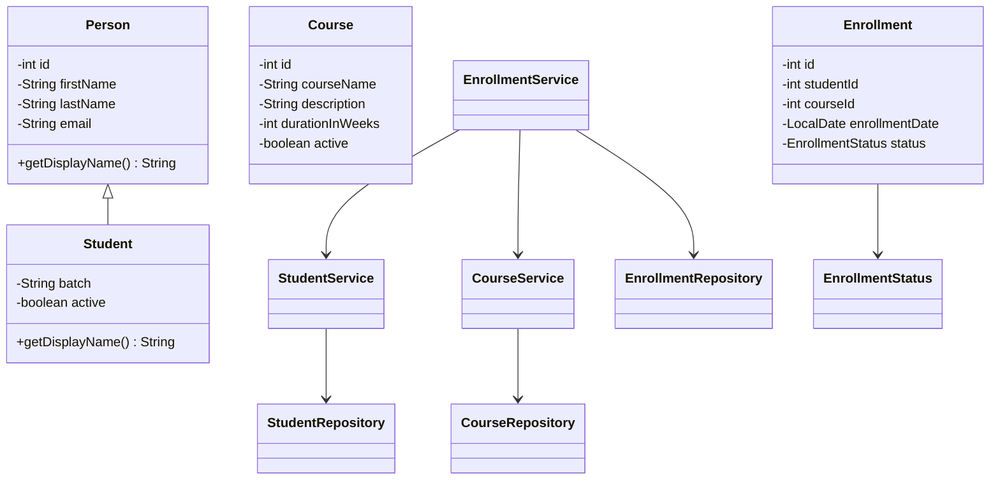

# LearnTrack — Student & Course Management System

## Project Overview

LearnTrack is a menu-driven Java console application for managing students, courses, and student enrollments. It demonstrates core Java programming, object-oriented design, collections, and basic exception handling.

## Features

### Student Management
- Add students with personal details, email, and batch.
- List all students.
- Search for a student by ID.
- Delete a student by ID.
- Validate required fields and email format.

### Course Management
- Add courses with a name, description, and duration.
- List all courses.
- Search for a course by ID.
- Delete a course by ID.
- Validate required fields and positive course duration.

### Enrollment Management
- Enroll an existing student in an existing course.
- Automatically generate enrollment IDs and record the enrollment date.
- Assign an initial enrollment status of `ACTIVE`.
- List, search, and delete enrollments.
- Reject enrollment requests when the student or course does not exist.

## Technologies Used

- Java
- Object-oriented programming (OOP)
- Java Collections Framework (`ArrayList`, `List`)
- Java `LocalDate`
- Exception handling
- Git and GitHub

## Project Structure

```text
src/
└── com/
    └── airtribe/
        └── learntrack/
            ├── Main.java
            ├── entity/
            │   ├── Person.java
            │   ├── Student.java
            │   ├── Course.java
            │   └── Enrollment.java
            ├── repository/
            │   ├── StudentRepository.java
            │   ├── CourseRepository.java
            │   └── EnrollmentRepository.java
            ├── service/
            │   ├── StudentService.java
            │   ├── CourseService.java
            │   └── EnrollmentService.java
            ├── util/
            │   ├── IdGenerator.java
            │   └── InputValidator.java
            └── enums/
                └── EnrollmentStatus.java

docs/
├── Setup_Instructions.md
├── JVM_Basics.md
└── Design_Notes.md
```

## Architecture

The application uses a simple layered structure:

- **Main:** Displays console menus and handles user input.
- **Service:** Applies validation and business rules.
- **Repository:** Stores and retrieves entities using in-memory lists.
- **Entity:** Represents students, courses, enrollments, and shared person details.
- **Util:** Provides ID generation and input validation.
- **Enum:** Defines valid enrollment statuses.

### Class Diagram



## Setup and Execution

1. Install a compatible JDK.
2. Clone or download this repository.
3. Open the project in an IDE such as IntelliJ IDEA or Eclipse.
4. Ensure the source root and package structure are configured correctly.
5. Run `com.airtribe.learntrack.Main`.

For detailed instructions, see [Setup Instructions](docs/Setup_Instructions.md).

## Storage

The application currently uses in-memory collections. Data is not persisted after the application exits.

## Documentation

- [Setup Instructions](docs/Setup_Instructions.md)
- [JVM Basics](docs/JVM_Basics.md)
- [Design Notes](docs/Design_Notes.md)

## Scope

This project focuses on core Java, OOP, collections, basic validation, exception handling, and clean separation of responsibilities. Database persistence and a graphical user interface are outside the current implementation.
